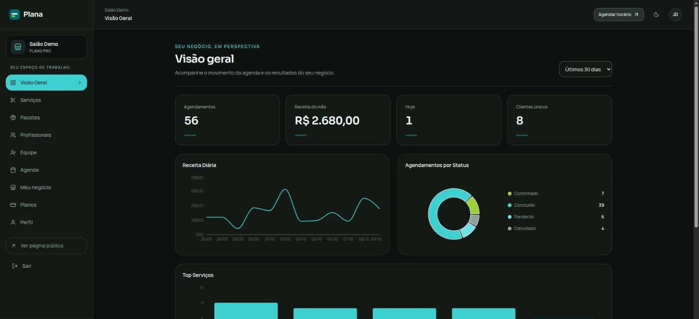
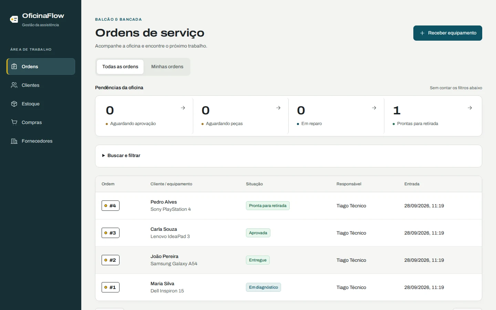
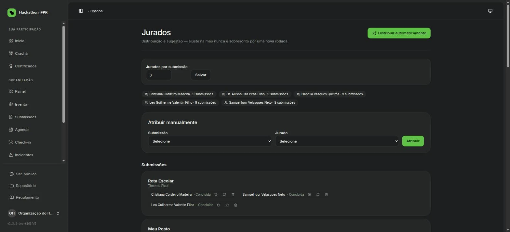
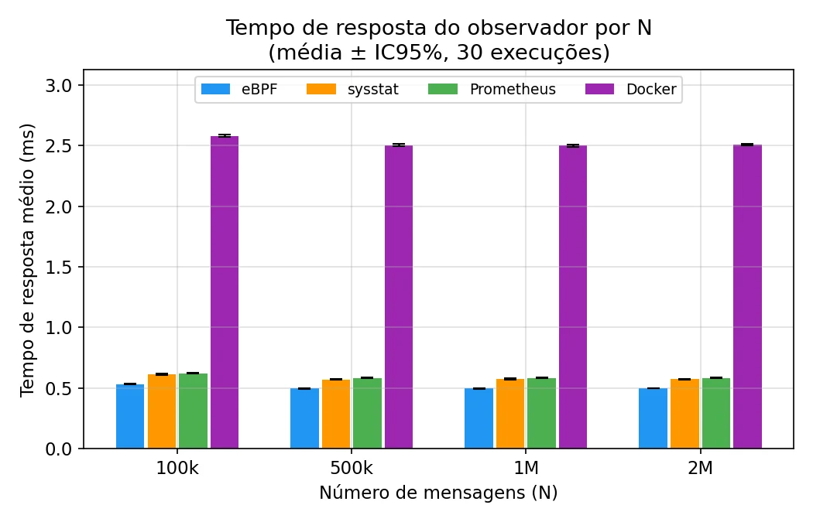

<a href="https://joaoplintaportfolio.dev/"></a>

<p align="center">
  <b>Desenvolvedor full stack, do banco de dados ao kernel.</b><br>
  Cursando Ciência da Computação no IFPR Pinhais. Construo sistemas que ficam no ar.
</p>

<p align="center">
  <a href="https://joaoplintaportfolio.dev/">Portfólio</a> ·
  <a href="https://www.linkedin.com/in/joao-pedro-plinta/">LinkedIn</a> ·
  <a href="mailto:joaopedrohenriqueplinta@gmail.com">E-mail</a> ·
  <a href="https://www.instagram.com/pinguim_joao/">Instagram</a>
</p>

---

## Em produção

<table>
  <tr>
    <td width="50%" valign="top">
      <a href="https://joaoplintaportfolio.dev/projetos/plana"></a>
      <h3>Plana</h3>
      SaaS de agendamentos, multi-tenant. PIX, cartão e webhook processado em fila.<br>
      <sub>Projeto individual, 68 commits</sub><br>
      <a href="https://joaoplintaportfolio.dev/projetos/plana">Estudo de caso</a> · <a href="https://www.planaapp.com.br/">Produto</a>
    </td>
    <td width="50%" valign="top">
      <a href="https://joaoplintaportfolio.dev/projetos/oficinaflow"></a>
      <h3>OficinaFlow</h3>
      Ordens de serviço com orçamento por versão e estoque em livro-razão, reserva tudo ou nada.<br>
      <sub>392 testes, 11 classes de concorrência em PostgreSQL</sub><br>
      <a href="https://joaoplintaportfolio.dev/projetos/oficinaflow">Estudo de caso</a> · <a href="https://github.com/joaopedroplinta/oficinaflow">Código</a>
    </td>
  </tr>
  <tr>
    <td width="50%" valign="top">
      <a href="https://joaoplintaportfolio.dev/projetos/hackathon-ifpr"></a>
      <h3>Hackathon IFPR</h3>
      Inscrições, equipes, jurados, resultado e certificados do 1º Hackathon do IFPR Pinhais.<br>
      <sub>Autor único do código, 205 commits</sub><br>
      <a href="https://joaoplintaportfolio.dev/projetos/hackathon-ifpr">Estudo de caso</a> · <a href="https://github.com/joaopedroplinta/hackathon-ifpr">Código</a>
    </td>
    <td width="50%" valign="top">
      <a href="https://joaoplintaportfolio.dev/projetos/tcc-monitoramento"></a>
      <h3>TCC: o custo de observar um sistema</h3>
      Overhead de eBPF, Sysstat, Prometheus e Docker monitorando um WAF, em 480 execuções reprodutíveis.<br>
      <sub>eBPF com menor tempo de resposta, de 13% a 15%</sub><br>
      <a href="https://joaoplintaportfolio.dev/projetos/tcc-monitoramento">Estudo de caso</a> · <a href="https://github.com/joaopedroplinta/vnf-monitoring-benchmark">Código</a>
    </td>
  </tr>
</table>

## Stack

**No dia a dia:** PHP, Laravel, TypeScript, React, PostgreSQL, Redis, GitHub Actions, Linux.<br>
**Também uso:** Python, C++, Java, Docker, Node.js.

---

```console
$ ping joaoplintaportfolio.dev
64 bytes from joaoplintaportfolio.dev: seq=0 ttl=64 tempo=instante ✓

$ echo "Tem uma ideia? Quer colaborar? Só quer bater um papo sobre tecnologia?"
Estou a uma mensagem de distância.
```
