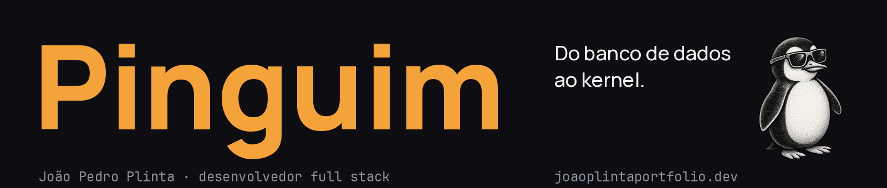
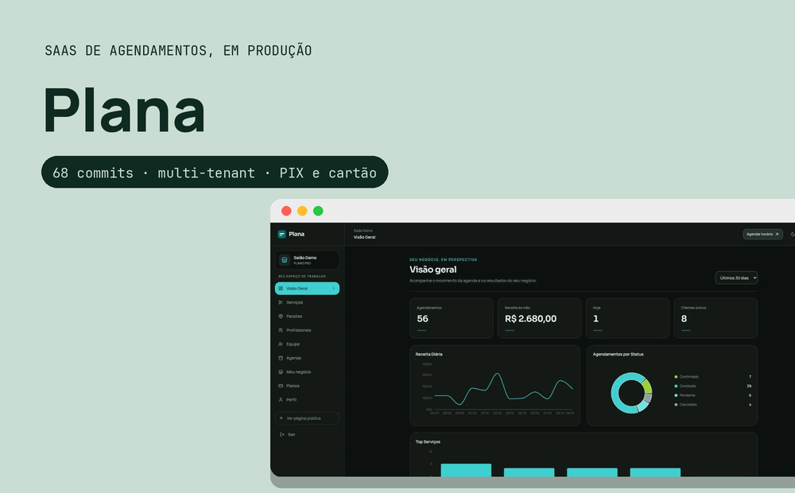
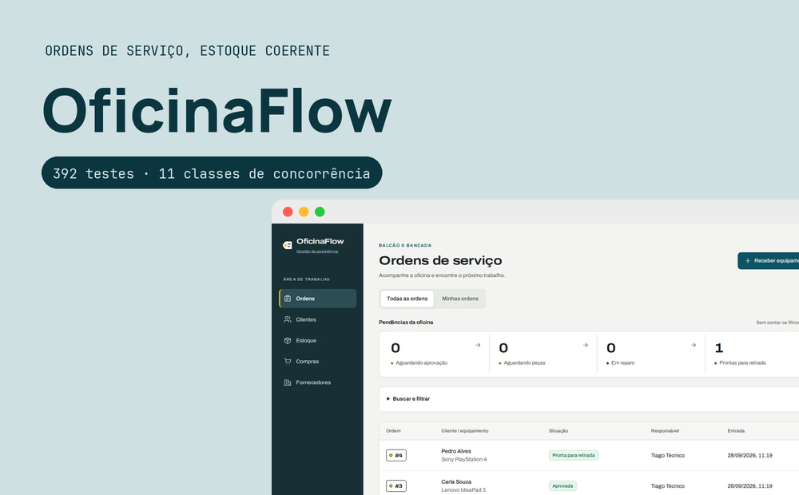
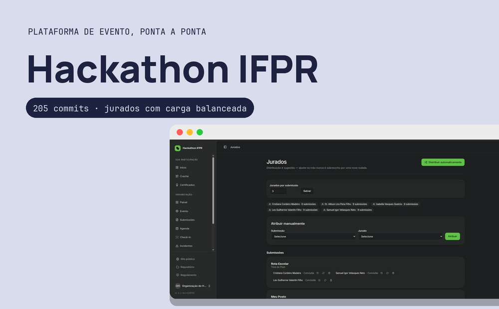
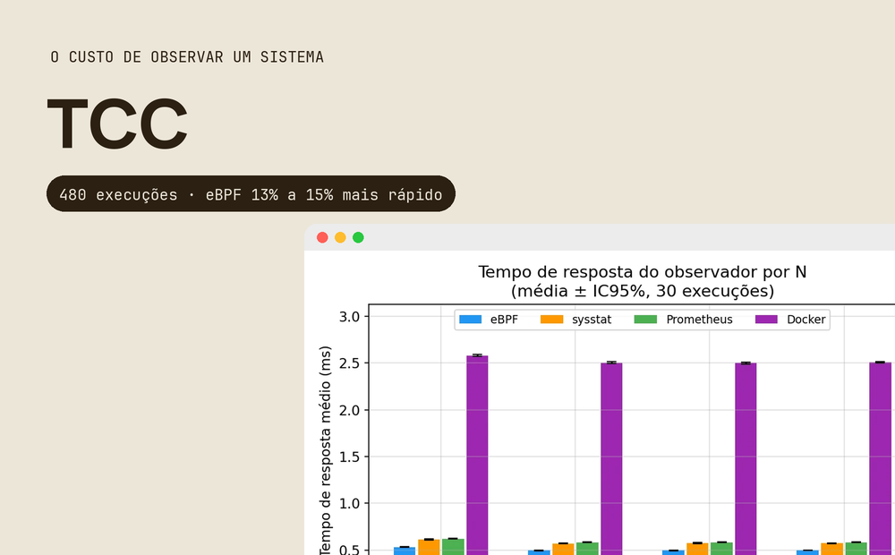

  <b>Desenvolvedor full stack, do banco de dados ao kernel.</b> 
  Ciência da Computação no IFPR Pinhais. Construo sistemas que ficam no ar.

  <a href="https://joaoplintaportfolio.dev/"><b>Portfólio</b></a> ·
  <a href="https://www.linkedin.com/in/joao-pedro-plinta/">LinkedIn</a> ·
  <a href="mailto:joaopedrohenriqueplinta@gmail.com">E-mail</a> ·
  <a href="https://www.instagram.com/pinguim_joao/">Instagram</a>

## Em produção

  
  
  
  

Cada card abre o estudo de caso no portfólio, com as decisões e os números conferidos no repositório.

## Stack

**No dia a dia:** PHP, Laravel, TypeScript, React, PostgreSQL, Redis, GitHub Actions, Linux. 
**Também uso:** Python, C++, Java, Docker, Node.js.

Tem uma ideia, quer colaborar ou só bater um papo sobre tecnologia? Estou a uma mensagem de distância.

